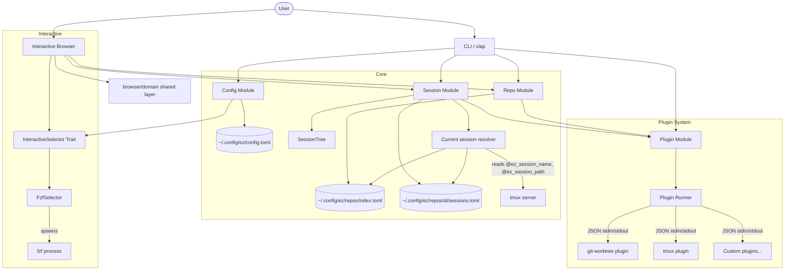
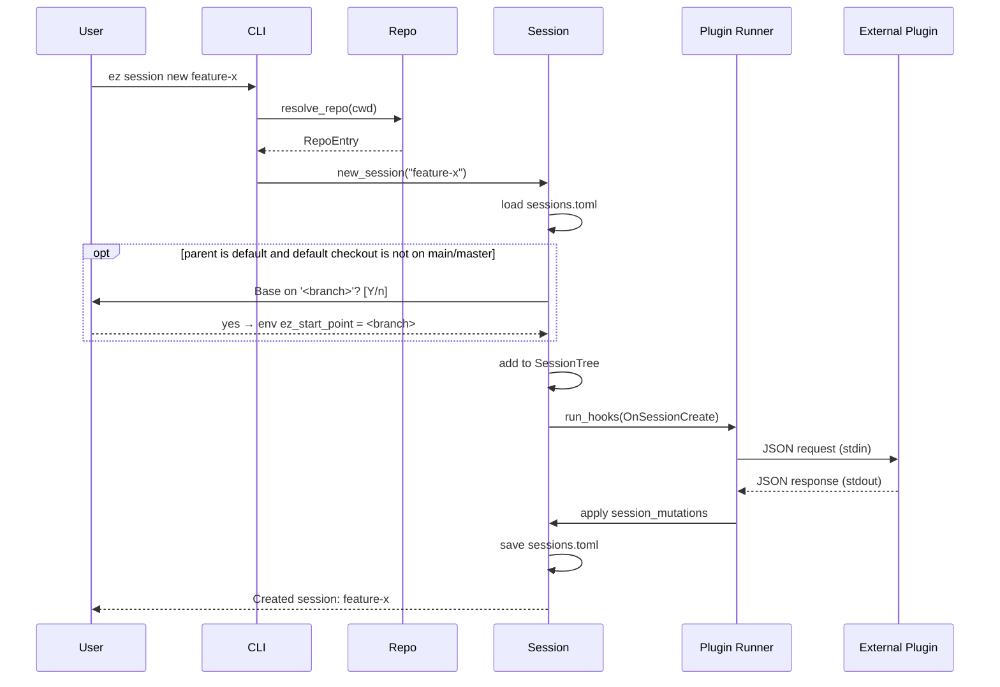
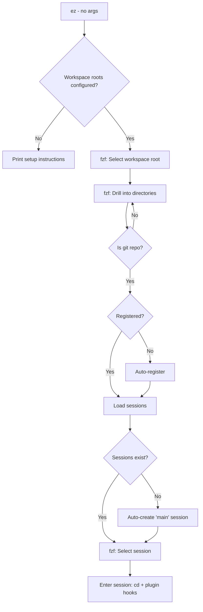
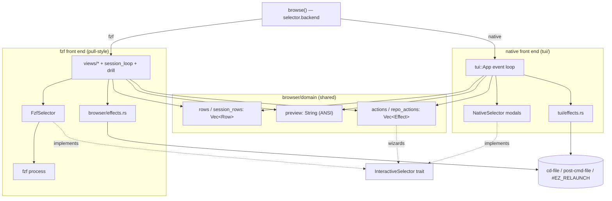
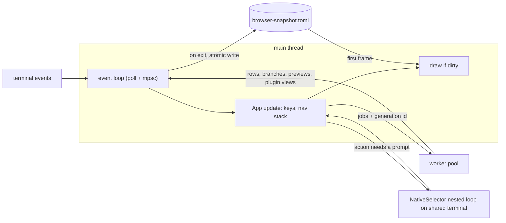
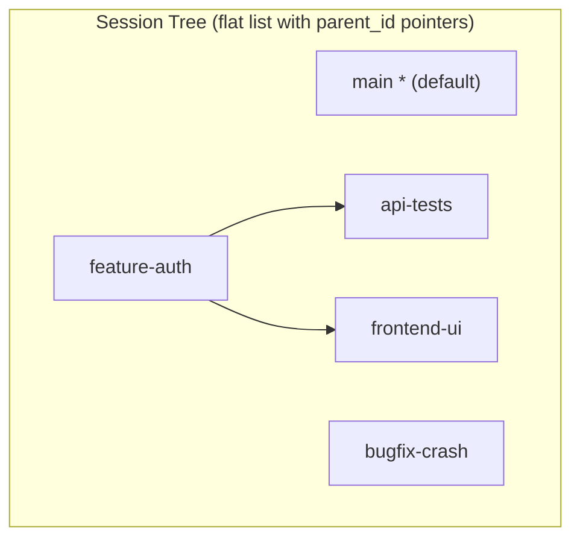
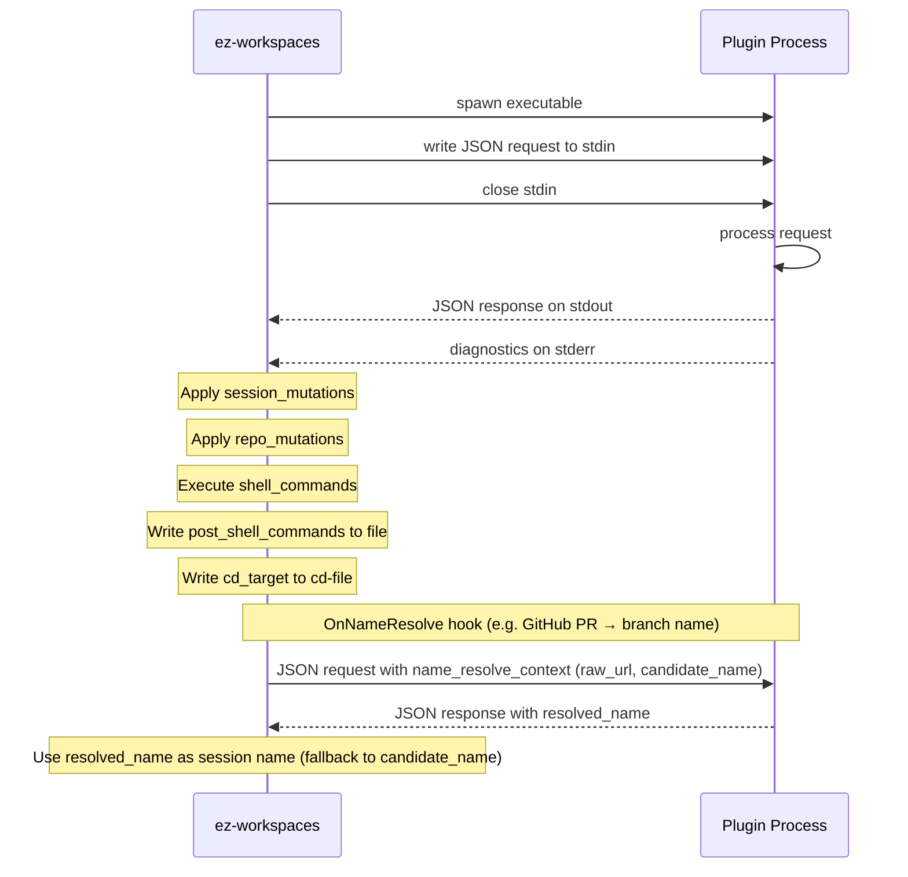
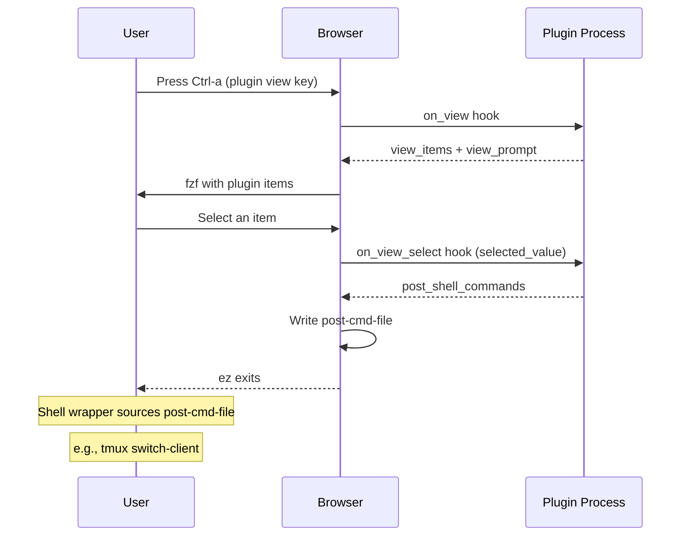
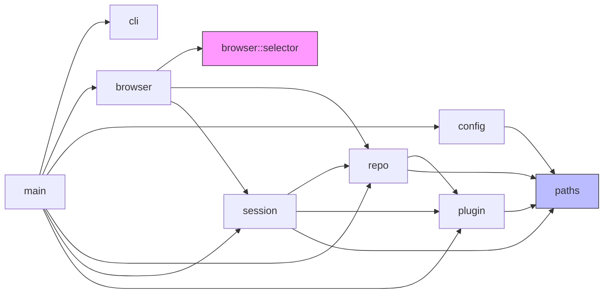
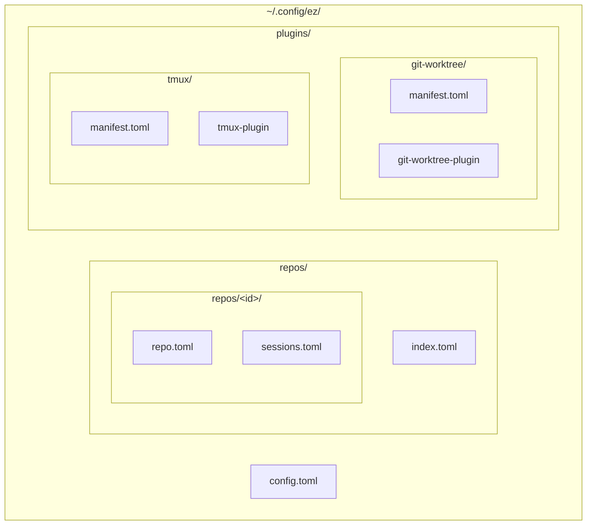

# Design

## High-Level Architecture

## Command Flow

`ez session register [path]` follows a shorter session flow: it resolves the git worktree root and common repo with `git rev-parse`, matches that repo to the registered repo index, then writes a `Session` with `path` set to the existing worktree. It does not run `OnSessionCreate`, because no worktree should be created.

## Interactive Browse Flow

## Browser Front Ends

`browser/domain/` holds everything that does not depend on the UI. Two front ends sit on top of it, selected by `selector.backend`.

Handlers return `Effect`s (`Cd`, `PostCmds`, `Exec`, `OpenNote`, `Refresh`, `Notify`, `Exit`) instead of writing files, and each front end applies them. The shell-wrapper contract (cd-file, post-cmd-file, relaunch marker) is identical in both.

### Native event loop

Stale worker results (older generation id) are dropped. Snapshot rows are replaced by fresh rows while the cursor stays on the same value.

### Stdio capture and suspend

The alternate screen must never receive stray output. `tui/stdio.rs` redirects fds 1 and 2 to a sink while the TUI is active and replays any stray output after teardown; `tui/capture.rs` collects handler output so it can be shown as a notification. Plugin binds that need the terminal (`Effect::Exec`) suspend the TUI (leave alternate screen, restore stdio), run the command, then resume; cd and post-command effects end the process so the shell wrapper can act on the files.

## Session Tree Model

## Plugin Protocol

## Plugin View Flow

## Module Dependencies

## Data Storage Layout

